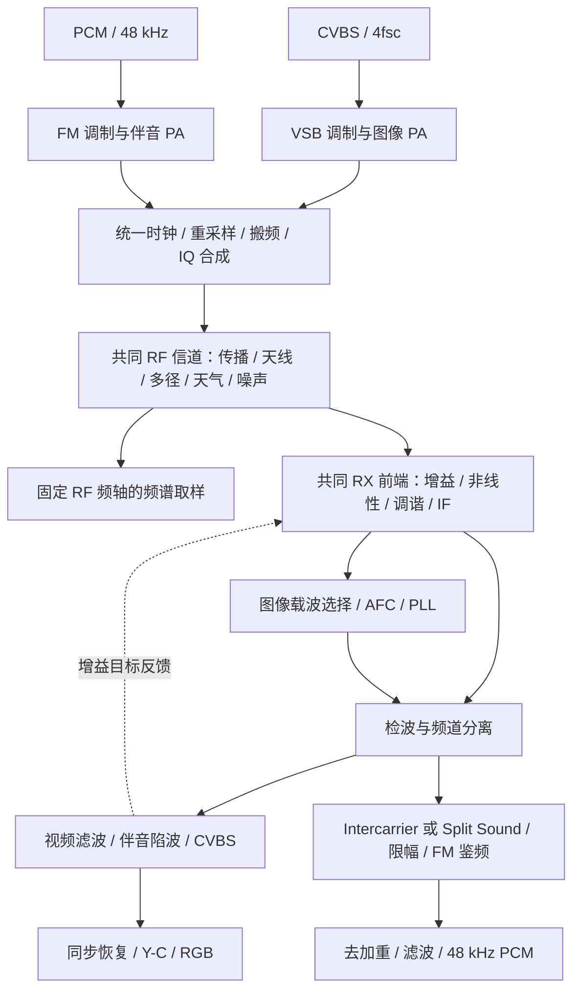

# 统一图像／伴音频道开发路线

工作分支：`codex/unified-tv-channel`，基线提交：`c7b1d7c`。
本文既是实现方案，也是实施记录。下面各节的接口草案对应首批实现；标为“尚未实现”的能力仍待完成。

## 实现状态

已完成（新路径与旧路径并存，默认入口暂未切换）：

- **第 1 步 · 拆分伴音收发。** 新增 `TVSoundModulator`、`TVSoundDemodulator`（`Sources/AnalogCore/TVSoundModulator.swift`、`TVSoundDemodulator.swift`）。`TerrestrialSoundEngine` 改为组合两者的旧路径基线，行为保持不变。
- **第 2 步 · 统一时钟、重采样与线性合路。** 新增 `TVChannelClock`／`TVChannelIQ`（`TVChannelSignal.swift`）、有状态带限复数重采样器 `TVComplexResampler`（`TVComplexResampler.swift`）、线性合路器 `TVChannelModulator`（`TVChannelModulator.swift`）。图像载波固定在 0 Hz，伴音搬至 `+soundCarrierHz`。
- **第 3 步 · 一次传播与共同前端。** `TerrestrialRFChannel` 增加 `TVChannelIQ` 入口；接收机前端拆为 `TVReceiverFrontEnd`（`TVReceiverFrontEnd.swift`），`TerrestrialReceiver` 变为“前端 + 检波”两段，并新增 `receive(TVChannelIQ)`。新增端到端 `TVUnifiedChannelEngine`（`TVUnifiedChannelEngine.swift`）：分离 PA → 线性合路 → 一次传播 → 共同前端 → 图像检波 + 伴音提取。
- **第 7 步（部分）· 图像载波选择。** AFC 先前置 250 kHz 载波选择，避免峰值白电平时伴音主导复合矢量而污染测频；PLL 仍跟踪完整信号，保证 `.reference` 与 `.accelerated` 数值一致。
- **第 8 步（部分）· 伴音陷波。** 检波后加入二阶 IIR 伴音陷波 `TVSoundNotch`，供共同检波路径抑制 4.5／6.5 MHz 拍频。
- **伴音提取。** 新增 `TVSoundExtractor`：从共同前端输出用连续 NCO 搬频并经带限重采样回到 384 kHz 窄带，再交给 `TVSoundDemodulator`（`projectFrontEnd: false`，即 Split Sound）。

测试：`TVChannelTests`（时钟连续性、重采样单音／镜像／混叠／跨块拼接、双载波频谱）与 `TVUnifiedChannelTests`（单通道图像锁定、音画同收、窄 IF 拒绝伴音）。

尚未实现：

- **第 4 步 · 共同 RX 增益与非线性**：前端过载、压缩、互调与 AGC 反馈尚未进入共同前端。
- **第 5 步 · Intercarrier 与视频滤波**：当前为 Split Sound 提取，Intercarrier 与可切换视频陷波策略未实现。
- **第 6 步 · 会话／GUI 集成与性能验收**：`TerrestrialEngine` 与 GUI 仍走旧的双分支路径；统一路径尚未接入渲染、频谱与 `TVSessionDocument`。
- 共同 PA 模式与 `sharedCoupling` 迁移策略。

## 目标和现状

目标是将 VSB 图像与 FM 伴音放进同一份频道 IQ，经过一次传播和共同接收前端，再完成图像与伴音恢复。非线性、检波、滤波及载波恢复造成的音画互扰应在信号链内产生。

目前入口在 `Sources/AnalogCore/Terrestrial.swift` 的 `TerrestrialEngine.process`：

- 图像：CVBS → VSB → 图像 PA → 图像 RF channel → `TerrestrialReceiver`。
- 伴音：48 kHz PCM → `TerrestrialSoundEngine.process` 内完成 FM、伴音 PA、另一套 RF channel、投影 IF、FM 鉴频及 48 kHz 输出。
- 图像沿用 PAL 17.734475 MHz／NTSC 约 14.318182 MHz 的 4fsc；伴音独立使用 384 kHz。
- 伴音拿图像接收机的 `carrierFrequency`、`currentGain` 作为控制参考。
- `visionPower`、`otherPower`、`sharedCoupling` 是分离包络之间的压缩近似，不是两个载波相加后的完整互调。
- 两路频谱均为传播后、调谐前的真实取样，但目前来自两份独立 IQ。

建议的最终结构：



共同接收前端是必需部分。发射端可以继续使用分别放大的图像／伴音再合路；若以后提供共同 PA，则放在合路后，并单独声明其设备模型。

## 1. 信号格式与时钟

现有：`TVStandard.swift`、`Terrestrial.swift` 中的 `TelevisionRF`、`TerrestrialSound.swift` 中的 `TVSoundClock`。
建议新增：`TVChannelSignal.swift`。

- `TVStandard` 继续描述 CVBS 扫描与 4fsc，保持 `TVEngine.encode/decode` 的输入格式。
- 新增 `TVChannelClock`：统一 RF 采样率、绝对样本边界、帧编号与时间映射。
- 新增 `TVChannelIQ`：`system`、`frameIndex`、`firstSampleIndex`、`sampleRate`、频率参考、I/Q 缓冲区。首版可固定以图像载波为 0 Hz，避免接收器、传播与 GUI 各用不同参考。
- 当前 `TelevisionRF.validate()` 强制采样率等于 4fsc、样本数等于视频帧计数。不要直接将高采样率数据塞入它；保留旧类型用于基准路径，通过显式转换进入新格式。
- PAL／NTSC 的帧与 PCM 边界沿用现有整数计数。每帧样本数必须由相邻绝对边界之差产生，不能把 `sampleRate/fps` 四舍五入后反复累加。
- 为无音轨、静音音轨区分语义：`audio == nil` 表示伴音载波关闭；全零 PCM 表示载波存在、节目静音。

采样率先作明确决策：名义 6／8 MHz 频道可先在现有 4fsc 上验证线性合路，但这不保证支持所有 10 MHz IF 设置，也不保证非线性展宽不会混叠。新格式应允许 RF 与 CVBS 使用不同采样率；高采样率 RF 回到 CVBS 前必须滤波、重采样。非线性阶段的 2×／4× 过采样是否足够，由频谱收敛测试决定。

## 2. 多采样率转换与搬频

建议新增：`TVComplexResampler.swift`，由合路器与伴音提取器共享。

- 实现有状态的带限复数重采样，保存 FIR 历史与分数相位；输入／输出的绝对时间对齐。
- 覆盖图像 4fsc → 频道采样率、FM 窄带 → 频道采样率、频道／检波输出 → 伴音窄带，以及需要时的音频 → 48 kHz。
- 现有 `TelevisionFIR.decimate` 只能直接处理整数抽取；4fsc 与 384 kHz 不是整数倍，不能取整抽取因子，也不能复用伴音中的固定 `/8`、`*8` 映射。
- 升采样滤镜需抑制镜像，降采样前需抑制带外成分。复数 IQ 使用简单线性插值不足以作为最终带限实现。
- 搬频 NCO 保持连续相位。按绝对样本索引或跨块保留状态，不能每帧归零。
- 分别记录滤波延迟、有效样本时间和输出数量，避免使用另一条源音频路径掩盖音画错位。

验收：复数单音的频率、幅度、镜像与混叠；跨块拼接和一次处理一致；连续 PAL／NTSC 帧输出 PCM 数量无累计漂移。

## 3. 拆分伴音引擎

现有：`TerrestrialSound.swift` 的 `TerrestrialSoundEngine.process`。
建议新增：`TVSoundModulator.swift`、`TVSoundDemodulator.swift`。

`TVSoundModulator` 只负责发送：

- 复用 `sourceFilter`、预加重、`audioDriveDB`、过偏移限幅、连续 FM 相位积分。
- 输出窄带复数 FM 及过调制遥测，默认保持现有图像同步载波／伴音载波 10:1 功率比。
- 默认先保留 384 kHz 窄带调制，再经带限重采样和搬频合路。
- 不在这里运行传播、公共 IF、接收增益或解调。

`TVSoundDemodulator` 只负责接收：

- 输入从共同接收信号中实际提取的窄带 IQ。
- 复用伴音 IF、相位差鉴频、去加重、15 kHz 音频滤波和 DC 阻断。
- 滤波系数与鉴频比例使用实际输入采样率；不得假定仍是固定 384 kHz，除非接口保证这一点。
- 输出数量由目标 PCM 时钟决定，不依赖“原始输入 PCM 数量”作为恢复依据。
- 单独报告检波后伴音载波电平与处理时间。

迁移期间保留 `TerrestrialSoundEngine` 作为旧路径对照，现有独立伴音测试仍能运行。完成音画互扰验证后再决定是否删除。

## 4. 合路与发射机

现有：`VSBModulator`（`Terrestrial.swift`）、`TVTransmitter.swift`。
建议新增：`TVChannelModulator.swift`。

- 保留 CVBS → 负调幅 → VSB 滤波过程和 Encoder／VSB 老化参数。
- 合路器将图像和伴音变换到相同采样网格：`combined = vision + sound × exp(j 2π Δf t)`。
- `Δf` 继续由 `TerrestrialSystem.soundCarrierHz` 给出：NTSC-M +4.5 MHz，PAL-D/K +6.5 MHz。
- 发射功率、伴音相对电平、馈线失配只能各作用一次。明确 PA 驱动、前向功率测量和 `deliver` 的顺序。
- 分离 PA 模式下分别放大再合路；共同 PA 模式下对合路 IQ 放大一次。共同 PA 模式不可再叠加 `otherPower` 的旧交叉压缩近似。
- `sharedCoupling` 的旧值要有迁移／保留策略，不能无声改变为另一种物理量。
- 共同 PA 的表计应测实际合成波形功率；默认分离 PA 的遥测需要明确测量点。

首个合路版本先旁路共同非线性，使用高 C/N 对照图像、伴音和功率。共同 TX PA 可放到后续阶段，先实现用户需要的共同 RX 前端。

## 5. 共同 RF 信道与天气

现有：`TerrestrialRFChannel`（`Terrestrial.swift`）、`TVSceneChannel`／`TVWeatherRF`（`TVPropagation.swift`）、`TVLightning.swift`。

- 把信道入口适配到 `TVChannelIQ`，每份合成 IQ 只调用一次传播、噪声、多径和天气处理。
- 统一延迟线、随机序列和事件时钟。避免图像与伴音分别生成两份雷击或重复叠加噪声。
- 混合 IQ 已包含伴音搬频；对它施加分数延迟，自然会产生伴音与图像之间的延迟相位差。不要再次叠加旧窄带分支的 `-2π × soundCarrierHz × delay` 补偿。
- 当前 `carrierOffsetHz` 同时用于传播频率评估与相位修正；必须明确“频道中心参考”和“独立窄带中心”的差别。
- 新 RF 采样率下噪声按谱密度缩放，保持现有 C/N 参考定义，不因过采样而改变最终信噪比。
- `TVWeatherRF` 的远台干扰目前根据 `carrierOffsetHz > 1e6` 区分图像／伴音。合路后需生成同一远台的 VSB＋FM，或明确首版只含远台图像，不能保留该条件后声称远台伴音仍已建模。
- 频道内增益可先采用参考频率处的传播结果；若要做频率选择性损耗，增加频率响应模型，不能用两个独立随机信道替代。

天气动画与 `TVLightningTimeline.events` 的关联保持现有机制：动画读取呈现帧的事件，不能跟随后台预生成时间提前闪烁。

## 6. 共同接收前端与 AGC

现有：`TerrestrialReceiver.receive` 的调谐／四路复数 IF FIR，以及 `TVDamageModels.swift` 的 `TVAGCDynamics`。
建议新增：`TVReceiverFrontEnd.swift`、`TVFrontEndSettings`。

- 将一次调谐、一次公共 IF 滤波、公共增益和输入过载作用到合成 IQ。
- 复用现有 IF 下界 −1.25 MHz、上界 `bandwidth − 1.25 MHz` 的定义，保持指示器与处理一致。
- 非线性可以分成 RF 输入级、IF 放大级；先明确每个器件在滤波／增益之前还是之后，以便测试过载和互调的差别。
- 增加可旁路的压缩、削顶、AM/PM 模型。复杂 RF 包络非线性和检波器的偶次／平方律响应需要分别实现。
- 复用现有 PA 的查表与并行思路，但 RX 有自己的饱和参考和状态，不能共享 TX 放大器实例。
- AGC 目标从实际视频同步尖端／背沿测量得到，再反馈到共同前端。现有增益是在相干检波后估计并作用到图像，需改为块反馈或流式控制。
- 首版可用前一块测得的目标控制下一块；明确启动增益、捕获速度和预卷。后续可缩短控制块而不是给同一整帧做两遍全链路。
- 手动增益、响应时间、过冲、亮度敏感参数保持意义；共同增益只能作用一次，视频还原阶段不能再次乘旧 `gain`。

需要增加共同前端输出／遥测：滤波后 IQ、使用的增益、过载状态、实际通带与分阶段耗时。

## 7. 图像载波恢复与共同检波

现有：`TerrestrialReceiver` 中的 AFC、`carrierPhase`／PLL、`demod` 生成。
建议拆出：`TVVisionCarrierRecovery.swift`、`TVSharedDetector.swift`。

- 现有 AFC 对公共 IF IQ 的相位变化求平均。加入伴音之后，直接照搬会让伴音和边带影响估计；先从实际 IF 中选择图像载波，再更新 AFC／PLL。
- 接收端只能使用收到的样本和选定制式，不读取发射端的瞬时载波相位作为恢复参考。
- 先提供相干检波基准，再增加共同包络／平方律检波及其校准。检测输出的频率范围要覆盖视频与伴音差频，避免过早低通掉伴音。
- Intercarrier 伴音从实际检波／两载波混频结果中提取，随后进行伴音带通、搬频、带限降采样、限幅与 FM 鉴频。
- Split Sound 对照方式从共同 IF 中单独选择伴音载波。两种方式共享真实前端，区别发生在检波／分离位置。
- 调谐漂移对 intercarrier 的共同频移抵消，与前端失谐导致的通带损失是两件事，测试应分别覆盖。
- 理想相位差鉴频会抑制纯 AM；互扰验证需检查实际载波相位污染、AM/PM 转换及有限限幅／滤波效果，不能只看包络摆动便宣称已经产生可听蜂鸣。

共同检波中的频差／倍频会扩展频谱。应在足够高的速率下计算，再滤波提取目标带；未做抗混叠时的蜂鸣和纹理不能算真实音画互扰。

## 8. 视频恢复与 CVBS 解码

现有：`TerrestrialReceiver` 中的电压还原、同步尖端／背沿箝位、H/V 恢复、`TVRasterDynamics`；`TVEngine.swift` 中的 Y/C 与 RGB 解码。

- 在公共检波输出之后增加视频低通与伴音陷波，再映射回 CVBS 电压。
- 伴音陷波应有明确的抑制／旁路策略；用于演示 sound-on-vision 的泄漏来自该信号路径。
- 若 RF 与 CVBS 采样率不同，在进入现有同步检测和 `TVEngine.decode` 前转换回精确的 4fsc 网格。
- 保留 −0.3 V 同步、0 V 消隐、0.7 V 白电平，以及 NTSC-M 7.5 IRE 的现有约定。包络／平方律模式必须重新校准这些电平。
- 保留 H/V/Color 指示、自由运行扫描、失锁保持与 Y/C 老化。滤波累计延迟要通过实测同步恢复和时间映射处理。
- CVBS Engine 不需要升级为高采样率 RF 引擎；边界仍是标准格式的 CVBS。

## 9. 总入口、渲染与播放

现有：`TerrestrialEngine.process`、`Sources/AnalogImaging/TVRenderer.swift`、`Sources/AnalogGUI/AnalogGUI.swift`。

- `TerrestrialEngine` 负责调制、合路、一次传播、统一接收和遥测汇总。删除新路径中第二次完整 `sound.process` 调用。
- 对外尽量保持 `process(CompositeVideo, settings, audio: [Float]?) -> TerrestrialReception`，让 `TVRenderer` 不随内部拆分反复改接口。
- `TerrestrialReceiver` 最终可以成为接收前端、载波恢复、检波、视频／伴音恢复的状态所有者。
- 细分 `TerrestrialTimings`：合路／重采样、共同前端、载波恢复、检波、伴音提取与解调、视频恢复。阶段不能互相重复计入总耗时。
- 所有 FIR、NCO、AGC、PLL、重采样相位按连续播放保留；跳转／换源／换制式通过重建 `TerrestrialEngine` 一次重置。
- `TVRenderer.renderFrame` 的预卷与跨帧机制复用。接收方式改变若更换内部拓扑，应触发一次接收重置；普通参数旋钮变化尽量保留历史。
- 伴音始终返回 48 kHz PCM，每帧数量符合 `TVSoundClock.count`，继续使用既有 1× 音频时钟、缓冲和迟到帧丢弃策略。
- FFmpeg PAL／NTSC 导入、PCM 缓存、`TVMediaCache`、`TVAudioOutput` 不需要为 RF 合路改变格式。

## 10. 频谱、控件和会话

现有：`TVSpectrum.swift`、`TVReceptionView.swift`、`TVSpectrumDragSurface.swift`、`TVReceiverRack.swift`、`TVControlState.swift`、`TVSessionDocument.swift`。

- 新增 `channelSpectrum`，直接测量共同 RF 信道输出、RX 非线性之前的整频道 IQ。
- FM 窄带视图也从同一 RF 取样点带限搬频／降采样获得；其 RBW 和中心频率使用实际测量值。不能把旧图像 FFT 和伴音 FFT 拼接后称为统一频道频谱。
- 需要观察 RX 自生互调时增加前端后的诊断取样点，明确测量位置；传播后频谱不能显示尚未发生的 RX 失真。
- 固定频率轴、offset 拖拽、IF 括号和 LCD 滤镜保留。新采样率下 IF 括号映射使用真实 RF 网格。
- 首版只在接收机检修面板加入前端非线性和 Intercarrier／Split Sound 选择，主面板先复用现有布局。
- 新配置应归属 RX 设置，而不是复用 `TVTransmitterSettings` 的 PA 控件。
- `TerrestrialSettings` 和嵌套配置目前用合成 Codable。新增字段即使有默认值，旧 JSON 缺字段仍可能解码失败；实现 `decodeIfPresent` 默认迁移或显式版本迁移。
- `TVSessionDocument.version` 目前为 1，`validate` 只接受 1。若升级版本，需要保留旧版读取与具体转换策略；不要只把版本号改成 2。

## 接口草案

以下仅用于明确职责，命名可调整；不应复制为缺少边界／延迟处理的占位实现。

```swift
// AnalogCore 内部：状态实例属于一次连续播放会话。
TVSoundModulator.modulate(pcm, frameIndex, settings) -> NarrowbandSoundIQ
TVChannelModulator.combine(vision, sound, clock, settings) -> TVChannelIQ
TerrestrialRFChannel.transmit(channelIQ, settings) -> TVChannelIQ
TVReceiverFrontEnd.process(channelIQ, settings) -> TVFrontEndOutput
TVVisionCarrierRecovery.process(frontEndIQ) -> MeasuredVisionCarrier
TVSharedDetector.process(frontEndIQ, measuredCarrier, mode) -> TVDetectorOutput
TVSoundDemodulator.demodulate(soundIQ, outputClock, settings) -> SoundReception

// AnalogImaging / GUI 继续通过这一边界接入。
TerrestrialEngine.process(composite, settings, audio) -> TerrestrialReception
```

## 推荐提交顺序

1. **拆伴音 TX／RX，不改变旧行为。** 独立伴音、天气／天线和跨帧测试通过后提交。
2. **统一时钟＋重采样＋线性合路。** 默认旁路新非线性，完成音画输出与旧路径的对照；显示两个真实载波。
3. **一次传播＋共同 IF。** 移除重复信道，验证噪声、雷击、延迟、窄 IF 伴音消失及频谱固定坐标。
4. **共同 RX 增益与非线性。** 完成 AGC 反馈、过载、标量参考及抗混叠验证。
5. **Intercarrier＋视频滤波。** 加入共同检波、真实伴音恢复和可重复的互扰测试。
6. **会话／GUI 集成和性能验收。** 参数迁移、接收方式切换、长时间原生窗口回放。

第 1 步最适合先接手；它能把混在一个函数里的发送、传播和接收拆开，又能直接利用现有测试判定是否保持行为。先让每个提交能运行，再切换默认路径。

## 测试与性能验收

复用：`TerrestrialTests.swift`、`TerrestrialSoundTests.swift`、`TVSpectrumTests.swift`、`TVPropagationTests.swift`、`TVDamageTests.swift`、`TVTXMeterTests.swift`、`TVPerformanceTests.swift`、GUI 播放与会话测试。
建议新增：重采样／统一频道／互扰专项测试。

- **线性基准：** 高 C/N、旁路新非线性，图像色条和音频单音恢复；声画幅度、偏移与延迟有量化指标。
- **功率与频轴：** 图像载波 0 Hz、伴音 +4.5／+6.5 MHz，功率比例正确；offset 只移动指示器，窄 IF 在真实接收中抑制伴音。
- **连续性：** 零输入 PCM 的载波存在；无音轨时关闭载波；跨帧相位、FIR 历史、PCM 数量、跳转和接收模式重置正确。
- **信道：** 同一雷击事件同时影响音画；多径相位与频率差吻合；改变采样率后噪声密度保持定义。
- **互调：** 两载波／两单音输入，检查互调频率与输入电平规律；提高过采样后目标带输出收敛，排除折返产生的假干扰。
- **图像到伴音：** 静音节目下改变图像亮度、同步／字幕与色度，测输出残余的频谱和相位污染；比较 Intercarrier／Split Sound。
- **伴音到图像：** 固定图像、改变伴音输入及陷波抑制，检查实际解码 RGB／CVBS 的变化，而非只测 RF 表计。
- **旁路与参考：** 所有新损伤旁路有基准结果；`.reference` 与 `.accelerated` 在连续帧及失锁／恢复情况下保持容差一致。

性能首先复用 CPU／Accelerate，缓存系数和 FFT 计划，限制工作缓冲区复制。重采样与 FIR 可并行分块；跨帧状态、相位反馈和控制环顺序执行。
PAL 帧预算约 40 ms，NTSC 约 33.37 ms。统计预热后的最大整帧耗时与超预算次数，并单独记录冷启动、系数切换、调谐拖拽和接收方式切换峰值。原生窗口长测同时报告实际速度、DROP 与音频欠载；预生成缓冲能够吸收尖峰，但不能替代引擎最大耗时验收。

## 构建与日常开发

根目录新增 `build.sh`，复用 `Scripts/build-app.sh` 的资源复制、Info.plist 和 ad-hoc 签名逻辑：

```sh
./build.sh                  # Release，输出 build/AnaLine.app
./build.sh --debug          # Debug，输出相同位置
./build.sh --test           # 先跑 Release 测试，再构建 App
./build.sh --debug --open   # 构建开发版，成功后打开 App
./build.sh --help

swift test -c release --filter TerrestrialSoundTests
swift test -c release --filter TVSpectrumTests
swift test -c release --filter TVPerformanceTests
```

Debug 用于开发和调试，不能作为实时性能基准。脚本不清理缓存、不修改分支、不自动提交；FFmpeg／ffprobe 仍需本机安装，运行时从 PATH 等已有解析路径查找。性能测试可能需要本地 `Assets/rickroll.mp4` 和相应 opt-in 环境变量，具体见测试文件与性能文档。

## 接收方式与非线性参考

- [NXP TDA9881：QSS／Intercarrier 图像与伴音 IF 解调](https://www.nxp.com/products/TDA9881HN)
- [US4513323A：Intercarrier 伴音中的图像载波相位污染与蜂鸣抑制](https://patents.google.com/patent/US4513323A/en)
- [Analog Devices：非线性、抗混叠及互调](https://www.analog.com/en/resources/analog-dialogue/articles/mixed-signal-components-for-digital-communications-systems-part-v.html)
