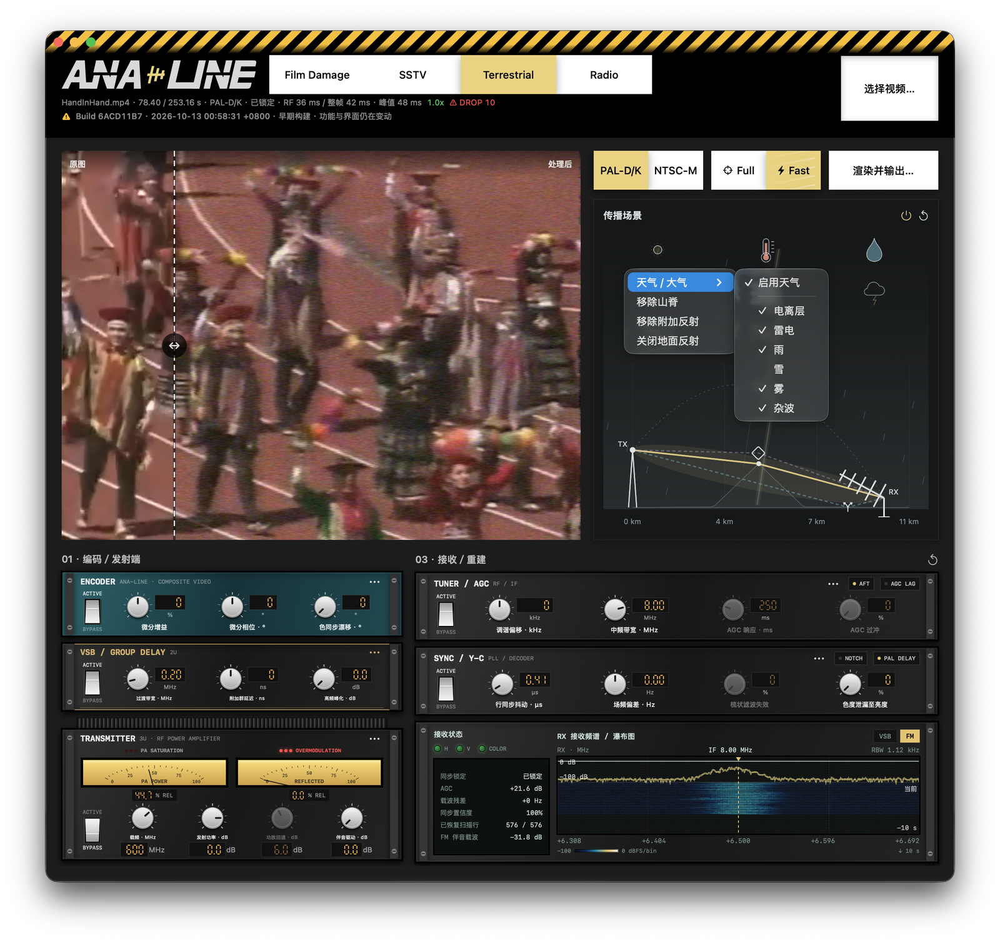
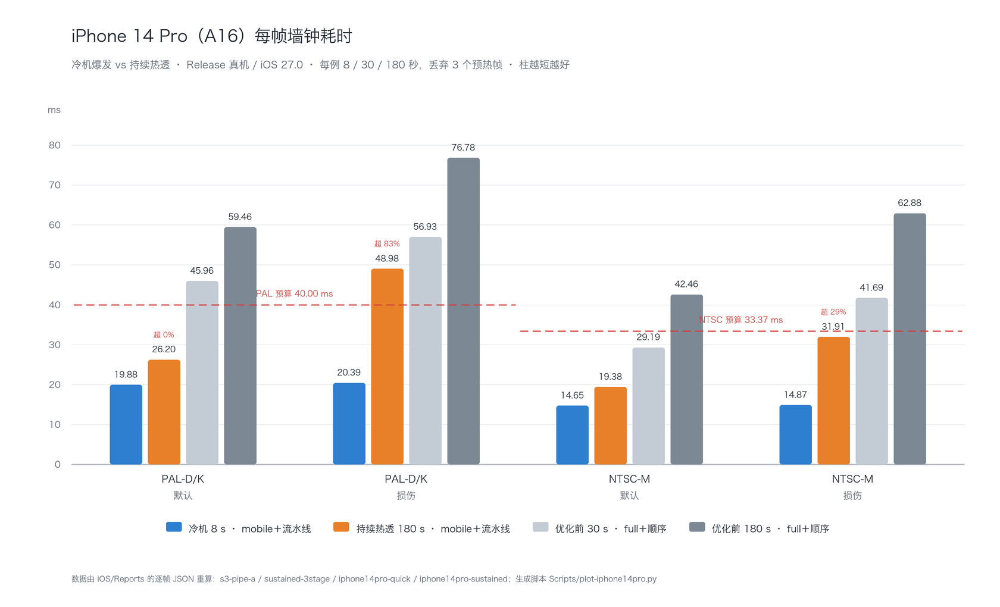

<p>
  <picture>
    <source media="(prefers-color-scheme: dark)" srcset="Design/Logo/ana-line-tv-proof.png">
    
  </picture>
</p>

AnaLine 是一个用 Swift 编写的模拟影像实验工具：它在 macOS 上把「信号损伤」做成可交互的链路，而不是滤镜。项目提供四种模式——胶片效果（Film Damage）、慢扫描电视（SSTV）、地面模拟电视（Terrestrial）与单声道 FM 收发仿真（Radio）。所有模型都是**可控的创意仿真**，不是经过实测标定的胶片系统，也不是通过标准一致性认证的广播设备。

**地面模拟电视是项目的重心。** 它把一帧画面编码为 CVBS，经负极性 AM／VSB 调制，与单声道 FM 伴音合成到同一个射频频道，再完整解调回来——中途经过地形传播、天气、接收机前端、AGC、载波恢复与同步重建。这条链路的仿真引擎叫 **AsyncAlter**。



*Terrestrial 工作区：左侧为原图／处理后对比监视器，右侧是传播场景与 RX 频谱／瀑布图，下方是「编码／发射端」与「接收／重建」两块机架。顶部读数显示 RF 接收 36 ms、整帧 42 ms、峰值 48 ms、1.0×、已锁定。*

## 四种模式

| 模式 | 内容 |
| --- | --- |
| **Film Damage** | LUT 调色（4 个资源库共 553 个预设）、程序颗粒、程序漏光；完整 ICC 与色彩空间处理链 |
| **SSTV** | Robot36、Martin M1、Scottie S1、PD120；逐行传输、时变信道、可接麦克风的实时 TX/RX |
| **Terrestrial** | PAL-D/K 与 NTSC-M 的 VSB 图像 + FM 伴音完整收发链路，含传播、天气与接收机 |
| **Radio** | 单声道 FM 收发仿真：预加重、连续相位 FM、IQ 噪声、调谐、IF 与鉴频 |

---

# 地面模拟电视 · AsyncAlter 引擎

<p>
  <picture>
    <source media="(prefers-color-scheme: dark)" srcset="Design/AsyncAlter/asyncalter-wordmark-v5.svg">
    
  </picture>
</p>

*AsyncAlter 的标志，矢量源文件为 [asyncalter-wordmark-v5.svg](Design/AsyncAlter/asyncalter-wordmark-v5.svg)。*

## 信号链

图像与伴音走**同一条**物理链路，共用增益、载噪比、多径与调谐参数：

```
RGB → CVBS → 负极性 AM / VSB → 图像与伴音功放 → 线性合成
    → 单个射频频道（传播场景、回波／多径、天气、电离层干扰、加性噪声）
    → 射频频谱取样点
    → 共用前端（一次共同增益、射频非线性、调谐、复数中频滤波、中频非线性）
    → 图像载波选择 / AFC → 载波 PLL
    → 检测与伴音分离（分离伴音或内载波、伴音陷波、可选视频低通）
    → 同步／色同步恢复与 Y/C → RGB
```

- **PAL-D/K**：625/50，8 MHz 频道，6 MHz 视频带宽；伴音 +6.5 MHz、±50 kHz 频偏、50 µs 预加重。
- **NTSC-M**：525/59.94，6 MHz 频道，4.2 MHz 视频带宽；发射时插入 7.5 IRE 黑电平基座，接收后移除；伴音 +4.5 MHz、±25 kHz、75 µs。
- 两者共用约 0.75 MHz 的 VSB 残留边带，图像／伴音功率比 10:1。
- 内部采用载波附近的**复数 I/Q 等效信号**，不直接采样 VHF/UHF 载波；图像在 4fsc 网格上，伴音在 384 kHz 网格上，统一到同一时间栅格。
- CVBS 电平：同步 −0.3 V、消隐 0 V、白 0.7 V。

实现细节、系数与验证范围见 [Terrestrial 技术记录](Docs/Terrestrial.md)与[统一频道设计](Docs/Unified-TV-channel.md)。

## 编码与发射机架

三块设备面板纵向堆叠，银白色翘板开关启用对应的老化／非线性模型；**BYPASS 只是旁路，编码、调制与发射照常进行**。所有旋钮支持拖动、滚轮、Shift 精调、双击复位与点击输入数值。

- **ENCODER**：微分增益、微分相位、色同步漂移；检修面板另有色同步幅度／相位。
- **VSB / GROUP DELAY（2U）**：滤波器过渡带宽、附加群延迟、高频峰化。过渡带越窄越容易振铃。
- **TRANSMITTER（3U）**：发射功率（−60 ～ +12 dB）、PA backoff、伴音驱动、载波频率（50 ～ 860 MHz）。功放 backoff 越小越容易压缩。
  - 表头 `PA POWER` / `REFLECTED` 显示相对参考功率的百分比，**没有瓦数标定**；负载 VSWR 增大时进入传播链路的功率随之减少。
  - 指示灯 `PA SATURATION` 与 `OVERMODULATION` 分别来自功放驱动包络饱和与图像 AM 包络反转／伴音限幅。

## 传播、天气与多径

传播场景是一张可交互的合并图：天空、地形、天线与反射路径画在一起。

- **天线**：拖动天线杆调整距离与高度，拖振子旋转仰角（±90°），滚轮调整 −5 ～ 25 dBi 增益，右键在偶极子／八木／对数周期／蝶形阵列间切换（切换会载入该类型的默认增益）。
- **地形**：右键天空添加山脊并拖动顶点改变高度与位置；地球曲率、天线方向与第一菲涅尔区仍由传播模型计算，**高度为夸张显示**。
- **多径**：右键添加一条附加反射路径，上下拖动菱形反射点改变等效额外路程（0 ～ 20 µs，即 c × 延迟），滚轮调整回波幅度，可编辑相位。点击地面调整地面反射强度。
- **折射**：折射曲线上的风形标记可拖动／滚动调整基础 k，点击查看包含天气作用的有效 k。
- **天气**：右键天空添加雨、雪、雾、雷电、电离层远台干扰与杂波；启用的元素直接绘制在天空里，雨雪密度与雾层同时画在 TX→RX 路径上。天气影响吸收、湿润表面损耗、杂波、假定折射梯度与热噪声。
- **雷电**：拖动雷云调整单次强度（0 ～ 100%）与平均频率（0 ～ 120 次/分钟，默认 30）；频率是随机发生的平均值，不是固定间隔。雷电向 RF 链路注入脉冲，**图像与 FM 伴音共同受影响**，整个面板会短暂亮起冷白光。

所有读数是相对量：黄色路径的悬停提示给出自由空间、绕射、方向、天气损耗与相对链路增益，**没有 dBm 标定**。

## 接收机与仪表

- **TUNER / AGC**：调谐偏移（±1500 kHz）、中频带宽（1 ～ 10 MHz）、AGC 响应／手动增益、AFT、AGC LAG（迟滞与过冲）。
- **共用前端**（检修面板）：前端增益与过载／非线性、输入与中频饱和、共同前端 AGC、视频低通、**分离伴音或内载波**检测、伴音陷波。
- **SYNC / Y-C**：COMB / NOTCH 切换、PAL DELAY、同步电路老化（行抖动、场频偏差、梳状滤波失效、色度泄漏至亮度）；检修面板另有行响应、行死区、行振荡器偏差与场捕获窗口。
- **同步指示灯**：H Sync / V Sync / Color Sync 三个独立灯——绿色为已检测到同步，橙色为短暂保持，红色为搜索中，灰色为无输入或预处理中。场同步或色同步丢失时，行同步可能仍然锁定。
- **接收读数**：锁定状态、载波残差、AGC、同步置信度、已恢复扫描行、FM 伴音载波电平。
- 失锁后**继续处理并显示自由运行的扫描画面**，而不是黑屏。

## 频谱与瀑布图

接收机下方是真实 RX I/Q 的频谱曲线与最近 10 秒瀑布图，VSB 与 FM 两条包络分别测量、可切换（没有合成为一个全频道采样信号）。

- 横轴固定为相对发射图像载波的 MHz；调整调谐时波形与历史**不平移**，琥珀色指示线移动到对应位置。
- 色标固定为 −100 ～ 0 dBFS/bin，弱信号不会被自动增亮；**不是 dBm 校准值**。
- 可直接在频谱上拖动指示线调整调谐、拖动括号端帽调整中频带宽；Shift 为十分之一灵敏度精调。
- 最新测量在顶部，每行 100 ms；暂停与调谐保留历史，跳转或换源清空。

## 伴音

音频混合为 48 kHz 单声道，走限带 → 预加重／限幅 → 连续相位 FM → 射频信道 → 伴音中频 → 相位差鉴频 → 去加重 → 低通。画面跟随音频消费时钟，暂停或跳转清空旧缓冲。**中频收得过窄时，可能还有画面却没有伴音。** 当前没有 BTSC/A2/NICAM 立体声，也没有图像引入的伴音蜂鸣模型。

## 播放、缓冲与读数

- 播放器固定 4:3，播放条位于画面内部底部，鼠标移入显示；空格播放／暂停。
- 时钟固定 1×；后台生成器默认提前处理 8 帧（设置中可调 1 ～ 60 帧），缓冲不足时丢弃过期帧而不是放慢速度。
- 顶部读数：RF 接收耗时、整帧处理耗时、当前倍率与峰值。整帧包含取帧、CVBS 编码、RF／伴音与图像转换，**不包含首次转码或跳转预卷，也不等同于窗口合成耗时**。1.0× 显示绿色，其他速度显示红色；丢帧时显示红色 DROP 与累计次数。
- 接收指标、同步灯与频谱按 100 ms 媒体时间桶刷新；天线、天气参数与工作区布局不随视频帧刷新。
- **Full / Fast**：默认 Full（参考精度）；Fast 使用经过容差验证的 mobile 档位。档位随会话保存。

## 视频导入

载入或拖入视频使用本机 FFmpeg / ffprobe（优先 PATH，再查找 Homebrew／MacPorts 常用目录）。首次导入解码一次并分成两个分支，分别生成 PAL-D/K 的 720×576/25 fps 与 NTSC-M 的 720×480/29.97 fps；48 kHz 单声道 PCM 只准备一次。

转换结果以原视频**完整 SHA-256** 与转换版本为键持久缓存（默认上限 20 GiB，可关闭），改名或移动相同内容仍可命中。切换制式直接使用缓存并把播放位置对齐到最近的目标制式帧，因此反复切换不会产生位置漂移。

## 会话与离线输出

- **会话**：`文件 → 保存会话`（⌘S）生成 `.analine`，保存视频引用、制式、全部编码／发射／传播／接收参数、噪声种子、播放位置与静音状态。会话不嵌入视频，找不到视频时可重新关联；播放位置超出新视频时长时自动限制到最后一帧。首版仅支持 Terrestrial。
- **离线输出**：`渲染并输出…` 把整段视频按当前制式与参数连续处理，输出**无损 PNG 视频 + 恢复后的单声道 float32 PCM** 伴音的 MOV（无音轨的源只输出视频）；仅完整成功后才替换目标文件。

---

# 引擎性能

每帧预算由制式决定：**PAL 40.00 ms、NTSC 33.37 ms**，下列数字均为每帧墙钟毫秒。macOS 数据来自 Apple M3 Max（14 核 CPU，Release，2026-10-09），走 `.full` 参考档位的顺序引擎，取自 [性能记录](Docs/Terrestrial-performance.md) 与 [Benchmarks 原始 JSON](Docs/Benchmarks/)；手机数据见下一节。

| 场景 | M3 Max · PAL-D/K | M3 Max · NTSC-M |
| --- | --- | --- |
| 核心链路（彩条 + 中等多径） | **29.40 ms**（34.02 fps） | **18.09 ms**（55.28 fps） |
| 持续播放 240 帧 | 均值 32.76，P95 34.64，最慢 37.02（超 0/240） | 均值 20.73，P95 21.21，最慢 25.59（超 0/240） |
| 全窗口 + RX 瀑布图（240 帧） | 均值 32.79，P95 34.67（超 0/240） | 均值 20.45，P95 20.74（超 0/240） |
| 传播 + 天气 + 功放（240 帧） | 均值 33.83，P95 35.73（超 0/240） | 均值 22.40，P95 22.84（超 0/240） |
| 尾部延迟（各 1200 帧） | 最慢 35.28（超 0/1200） | 最慢 24.13（超 0/1200） |
| 可见 NSWindow，约 30 s | 最慢 35.88（超 0/765） | 最慢 27.38（超 0/918） |
| 全部损伤／老化模型 + 天气 | 最慢 36.17（超 0/766） | 最慢 24.88（超 0/919） |

括号内是超预算帧数。首轮优化把核心链路从 149.15 / 100.53 ms 降到 36.47 / 23.41 ms（约 4.1× / 4.3×），此后维持实时余量。

## iPhone 14 Pro 真机（A16）

同一台 14 Pro 上，**冷机与热透的差距比任何一次代码改动都大**：冷机时四个场景全部进预算，持续热透后 PAL 损伤会掉到 122%。下面把所有状态并在一张表里，每例 8 / 30 / 180 秒，丢弃 3 个预热帧；括注 P95，`超` 为该场景的超预算帧数。

| 状态 | PAL-D/K 默认 | PAL-D/K 损伤 | NTSC-M 默认 | NTSC-M 损伤 |
| --- | ---: | ---: | ---: | ---: |
| **帧预算** | 40.00 | 40.00 | 33.37 | 33.37 |
| **冷机** 8 s 爆发 · mobile＋三段流水线 | **19.88**（P95 22.33） | **20.39**（P95 21.95） | **14.65**（P95 15.94） | **14.87**（P95 15.93） |
| **冷机** 30 s 快速 · mobile＋三段流水线 | — | 20.59（P95 22.67，峰值 33.57） | — | 15.03（P95 16.21，峰值 19.27） |
| **持续热透** 180 s · mobile＋三段流水线 | 26.20（P95 34.13，超 1/4499） | **48.98**（P95 63.19，超 2937/3555） | 19.38（P95 22.81，超 0/5394） | 31.91（P95 36.79，超 1548/5293） |
| 优化前 30 s 快速 · full＋顺序引擎 | 45.96 | 56.93 | 29.19 | 41.69 |
| 优化前 180 s 持续 · full＋顺序引擎 | 59.46 | 76.78 | 42.46 | 62.88 |



- 冷机两行的超预算帧数都是 0；优化前基线的每个场景都超预算（NTSC 默认快速仅 2/898 帧超）。持续热透下的实际交付速率：PAL 默认 100%、NTSC 默认 100%、NTSC 损伤 98%、PAL 损伤 79%。
- 冷机爆发与持续热透相差 **2.3 倍**（PAL 损伤 21.4 → 49.0 ms），几乎全部来自降频而不是工作量；持续数字在同一天内也会随设备历史热状态漂移（仅损伤场景的复跑为 33.33 / 31.31 ms），所以持续测的绝对值只能与同一次会话内的配对比较。
- 上面三档都固定在 **mobile** 档测量；iOS App 在 serious／critical 时会自动切到更省的 `hot` 档，该档尚无真机报告。
- 原始报告：冷机爆发 [s3-pipe-a.json](iOS/Reports/s3-pipe-a.json)、冷机 30 s [qos-ui-b.json](iOS/Reports/qos-ui-b.json)、持续 180 s [sustained-3stage.json](iOS/Reports/sustained-3stage.json)、仅损伤复跑 [therm-unl-a.json](iOS/Reports/therm-unl-a.json)；优化前基线见 [真机报告](iOS/Reports/iPhone14Pro-results.md)；交错 A/B 与归一见 [流水线与测量记录](iOS/Reports/p2-pipeline.md)。

**没有达标的地方也一并列出**，因为它们界定了当前边界：

- **右侧传播侧栏的三种窗口布局全部失败**（PAL 最慢 43.90 / 65.90 / 59.94 ms，超预算 2 / 3 / 10 帧）。
- **iPhone 14 Pro**：持续热透下只剩 **PAL 损伤不达标**（48.98 ms，122%）；NTSC 损伤均值 31.91 ms 虽在预算内，但 P95 36.79 ms、29% 的帧超预算。**手机实时依赖热状态，不能用冷机数字承诺长时间播放**。
- **iPhone 16 Pro**（mobile 档、尚无三段流水线的旧构建，180 s／场景）：PAL 默认均值 29.83 ms、能力 134%、超预算 0；PAL 损伤 49.50 ms、能力 81%；NTSC 默认 26.28 ms（超 4 帧）；**NTSC 损伤 34.92 ms，超预算 85%**。同一构建下 14 Pro 的数字见上表；16 Pro 尚未用三段流水线复测。

## 档位：Full / Fast / hot

`TVChainProfile` 定义三档，**卷积核半径在两档中保持不变**，只调整精度与抽样步长：

| 参数 | Full（默认） | mobile（Fast） |
| --- | --- | --- |
| 伴音重采样精度 | 双精度 | 单精度 |
| FM 相位调度 | 参考实现 | 精确整数调度 |
| 载波 PLL 步长 | 1 | 2 |
| 噪声生成 | 顺序 Box-Muller | 并行 Box-Muller |
| 功放表点数 | 8192 | 2048 |
| 功放耦合步长 | 1 | 4 |
| AFC 锁定后抽取 | 1 | 8 |
| 频谱窗口 | 8 | 2 |

第三档 `hot` 在系统热状态为 serious／critical 时自动生效（功放表 1024 点、耦合步长 8、AFC 抽取 16、频谱窗口 1）。

档位不是免费降级，代价已被量化：PLL 步长 2 对应「PAL ≤0.003 / NTSC ≤0.005 峰值 RGB 误差」，子采样交叉压缩「≤0.001」，8× AFC 抽取「(0.000)」。**缩短伴音上采样卷积核的方案被明确否决**——半径 5 / 4 / 3 的峰值 RGB 误差为 0.029 / 0.057 / 0.086（PAL），NTSC 更是 0.025 / 0.57 / 0.80。设备端交替配对 A/B 显示 mobile 的每帧耗时收益约为 **−11% ～ −14%**（未改阶段归一化中位差），同一批配对中 mobile 完成帧数不少于 full 的比例为 23/24。三段流水线在此之上再压缩一轮：冷机爆发四个场景全部达标，持续热透下只剩 PAL 损伤超出预算（见上一节）。

## 加速现状（含负面结论）

`TVMetalAccelerator` 只覆盖四个稠密阶段：复数 FIR（图像 VSB 与接收中频）、NCO 复数混频、发射功放传递曲线、RF 热噪声生成。其余全部是 CPU + Accelerate（SIMD / vDSP / vForce）——逐样本的 PLL 反馈、AGC 与同步检测本质上保持串行。

实测结论是 **GPU 不值得接入主链路**：复数 FIR 在 GPU 上慢 2.5 ～ 3 倍，NCO 慢 1.3 ～ 2.5 倍；只有功放查表在 iPhone 16 Pro 上快 1.73×（2.92 → 1.68 ms），而 14 Pro 上反而慢 1.37×。CPU 侧复数 FIR 吞吐实测约 100 ～ 170 GMAC/s。该加速器**目前没有接入链路**。

## 方法学与限制

- macOS 数据来自 `swift test -c release --filter TVPerformanceTests`（彩条、10 帧、丢弃前两帧、取后 8 帧均值）以及 Renderer / Playback 基准写出的 `M3Max-*.json`；不含载入与跳转预卷。
- 该测试是**诊断基准，不含与机器相关的速度断言**，只断言数值容差（CVBS 样本 < 0.000002、解码 RGB < 0.00001、完整 RF RGB < 0.00005 等）。
- iOS 采用 8 s 爆发（A/B 诊断）、quick 30 s 与 sustained 180 s，丢弃 3 个预热帧；`processingMS` 不含校验、遥测、写报告、UI 呈现与节流，音频也不播放。**超预算计数不等于实测播放掉帧，该测试不证明音画同步。**
- 报告逐帧记录系统热状态：**「冷机」指 nominal／fair，「热透」指 serious**。同一场景两者可差 2.3 倍，因此 8 秒爆发只能用于相对比较，判断是否实时必须看持续测。
- 以上数字**均不构成实时保证**：只覆盖该机器、该场景与该测量时间，不包含首次 FFmpeg 归一化、跳转预卷与 SwiftUI 显示开销，也不代表任意后台负载下的硬实时保证。设备温度与频率未被直接测量，同一台设备两次会话之间的漂移可以超过 100%，因此 A/B 必须配对进行。

---

# 安装与构建

要求 macOS 13 或更新版本，以及支持 Swift 6 的 Xcode 或 Command Line Tools。Swift 包**没有第三方依赖**；部分 LUT 首次使用时联网下载并按 Git blob SHA 校验。

```sh
./build.sh              # Release，输出 build/AnaLine.app
./build.sh --debug      # 开发版（DSP 未优化，不适合性能测量）
./build.sh --test       # 构建前先跑 swift test
./build.sh --open       # 构建后打开
```

`sh Scripts/build-app.sh [release|debug]` 仍然可用（build.sh 是它的封装）。

直接从源码运行：

```sh
swift run -c release AnaLine            # 启动 GUI
swift run -c release AnaLine /路径/image.jpg
swift test                              # 全部测试
swift test -c release --filter TVPerformanceTests   # 性能基准
swift test --filter FMTests                         # Radio 链路
```

SSTV 的麦克风输入与 TX 声音监听需要运行打包后的 `build/AnaLine.app`（需要 Info.plist 中的用途声明与本地 ad-hoc 签名）。Terrestrial 需要本机安装 **FFmpeg 与 ffprobe**；它们作为外部程序调用，不随项目分发。

## 命令行工具

`analog` 保留独立的 CPU 效果链，与 GUI 渲染流程不同：

```sh
swift run analog --demo /tmp/analog-demo.png
swift run -c release analog input.jpg output.png
swift run -c release analog input.jpg output.png recipe.json
```

# iOS

- `iOS/AnaLine.xcodeproj`（scheme `AnaLine`，bundle ID `com.analine.ios`，iOS 17+）：iOS 端 App，原生解码、4:3 适配、连续流水线、会话导入导出与离线输出。详见 [iOS 初版说明](iOS/INITIAL-APP.md)。
- `iOS/AnaLineBenchmark.xcodeproj`：性能诊断 App，直接在设备上测量 `TVUnifiedChannelEngine` 各阶段耗时。方法与字段说明见 [iOS 基准说明](iOS/README.md)。

# 项目结构

| 路径 | 内容 |
| --- | --- |
| `Sources/AnalogCore` | 全部仿真核心：CVBS／VSB 链路、传播与天气、SSTV、Radio FM、LUT 解析 |
| `Sources/AnalogImaging` | 渲染与媒体：Metal 颗粒、Hald／CUBE 渲染、FFmpeg 进程、导出 |
| `Sources/AnalogGUI` | SwiftUI 界面：四种模式、机架控件、传播场景、频谱与瀑布图 |
| `Sources/analog` | 命令行图片处理器 |
| `Tests` | 单元／回归／渲染测试与 PySSTV 频率夹具 |
| `iOS` | iOS App、基准工程与测量报告 |
| `Design` | 标志、图标与设计稿（含本文使用的两个标志） |
| `Docs` | 技术记录、性能数据与使用说明 |
| `Assets`, `Demos` | LUT 资源与 AV 串扰演示 |

# 文档

- [使用说明](Docs/Usage.md)——四种模式的完整操作说明与算法限制
- [Terrestrial 技术记录](Docs/Terrestrial.md)、[统一频道设计](Docs/Unified-TV-channel.md)
- [性能记录](Docs/Terrestrial-performance.md)、[性能原始数据](Docs/Benchmarks/)
- [Radio FM](Docs/Radio-FM.md)、[SSTV 调研](Docs/SSTV-research.md)、[颗粒模型](Docs/Grain-model.md)
- [待处理技术债](Docs/Technical-debt.md)、[参考项目](Docs/References.md)

# 许可

原创代码、文档与设计文件采用 **[GNU AGPLv3](LICENSE)**（中文译文见 [LICENSE_zh-cn.txt](LICENSE_zh-cn.txt)，为非官方译文，以英文原文为准）。

第三方 LUT 与素材保留各自许可，**不在本项目的 AGPL 授权范围内**：来源、许可证与参考用途汇总于[第三方许可说明](THIRD_PARTY_NOTICES.md)与[参考项目列表](Docs/References.md)。部分 LUT 上游仅提供集合级许可声明，单项资源的权利链仍未核实。

Bliss 壁纸、测试视频与 `Assets/HandInHand.mp4` 属于本地测试素材，默认不纳入版本控制；克隆项目后请使用自己的图片与视频。
